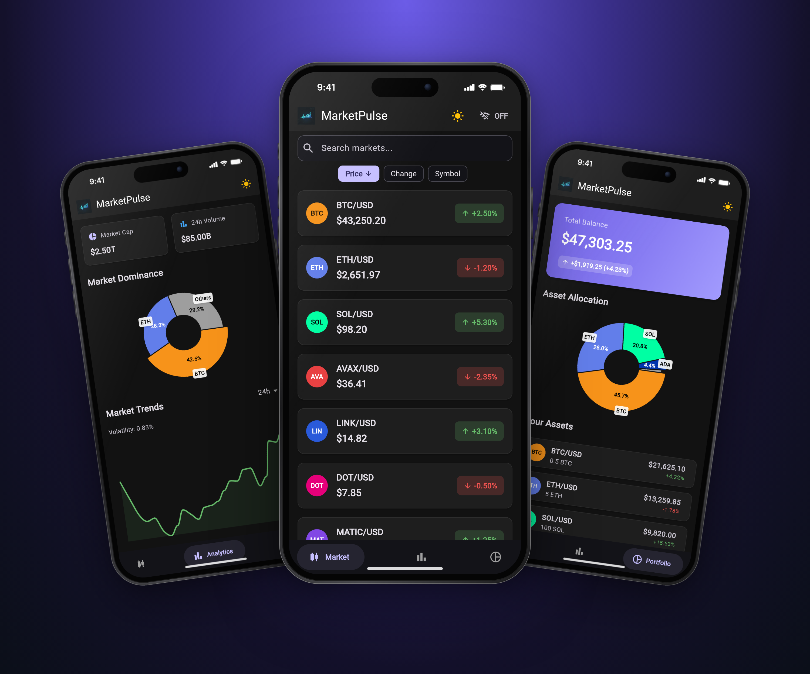
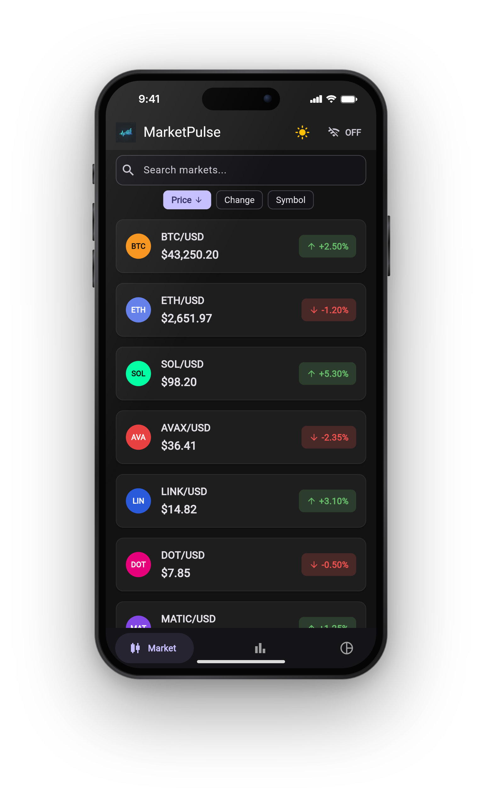
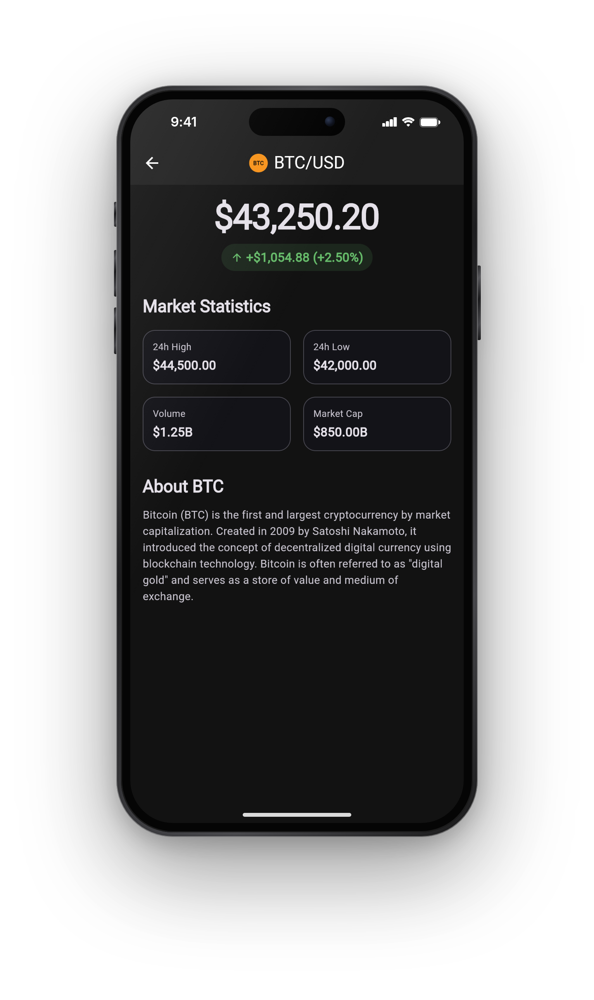
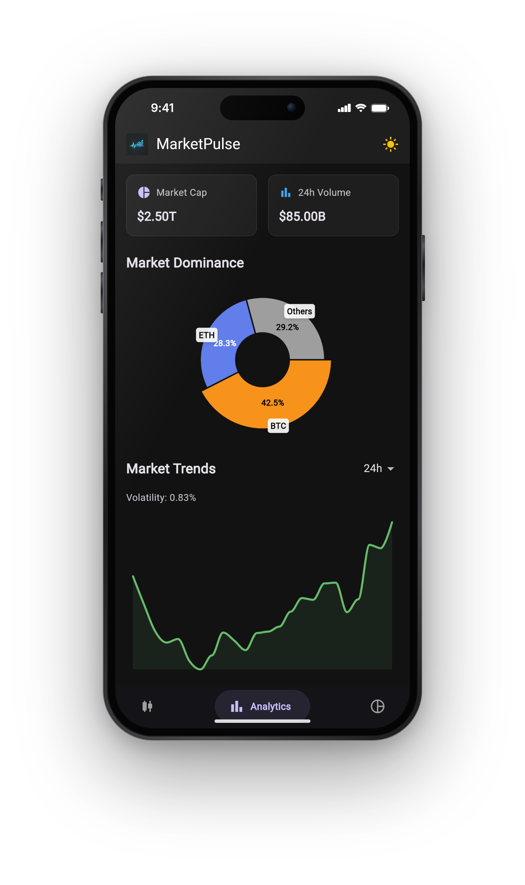
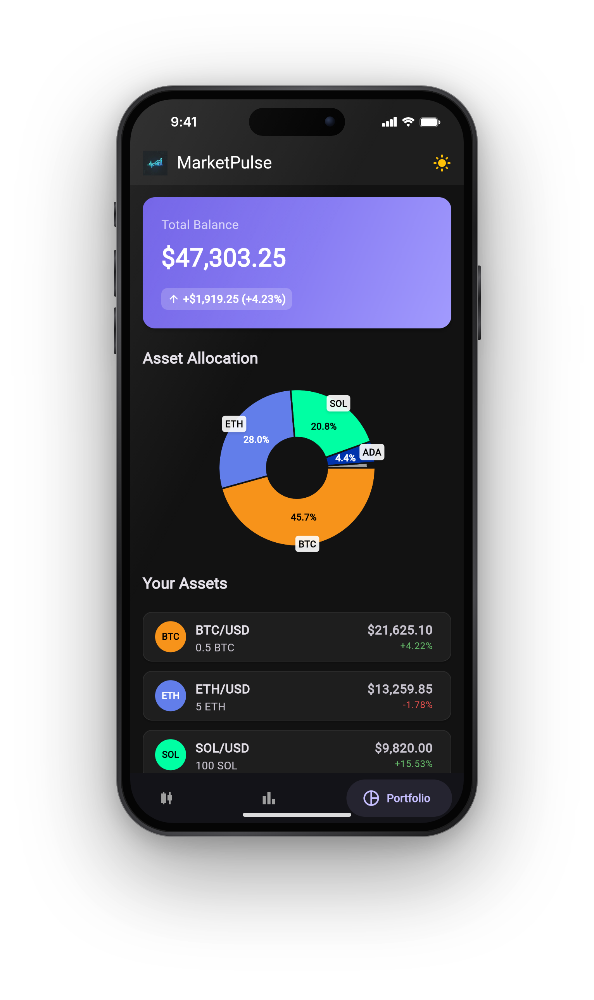
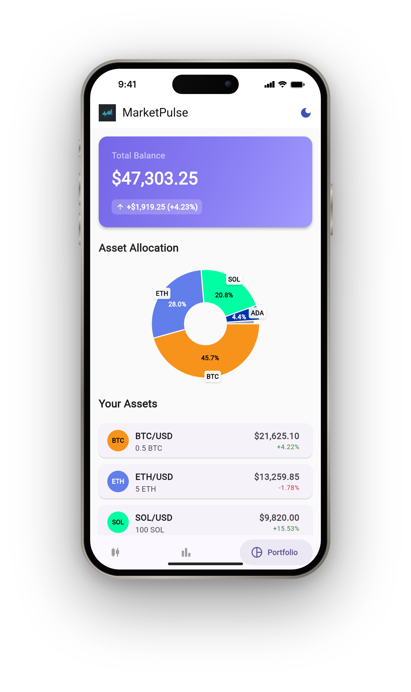
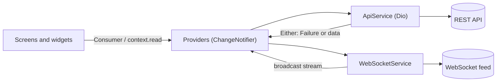

# MarketPulse

[](https://github.com/defoibrahim/marketpulse-flutter/actions/workflows/ci.yml)

<p align="center">
  
</p>

MarketPulse is a Flutter crypto market tracker. It lists markets with prices that update live over a WebSocket, opens a detail view for each pair, charts market trends and dominance, and breaks a portfolio down by allocation and P&L. It ships with a dark theme and a light theme.

I built it as a practice project to work through a realistic data-heavy mobile app: a REST client with typed failures, a live price stream, Provider-based state with loading, error and empty states, and charts.

## Screenshots

<p align="center">
  
  
  
</p>
<p align="center">
  
  
</p>

The screenshots are real captures of the app running in demo mode, taken by the [Screenshots workflow](#screenshots-1) (see [Data source](#data-source)).

## Features

- **Market list**: every pair with price and 24h change, colour-coded up and down.
- **Live prices**: a LIVE/OFF toggle in the app bar subscribes to a WebSocket feed and shows whether it is connecting or connected. Ticks are applied by symbol in O(1) and UI rebuilds are throttled to one per 100 ms, so a fast stream can't flood or starve the UI. The socket reconnects with exponential backoff and closes while the app is in the background.
- **Search and sort**: filter by symbol, sort by price, change or symbol, and tap a chip again to flip the order.
- **Market detail**: price, 24h change, high and low, volume and market cap, with pull-to-refresh.
- **Analytics**: total market cap and volume, BTC/ETH/others dominance (donut chart), a trend line with a 1h to 30d timeframe picker, and the top gainer and loser.
- **Portfolio**: total balance and P&L, an allocation chart (top four holdings plus "others") and the holdings list.
- **Polished states**: skeleton loading with Skeletonizer, a progress bar, retryable error views, empty and no-match states.
- **Dark and light themes**: Material 3 themes seeded from one brand colour. The app follows the system theme until you pick one, then remembers your choice. Gain and loss colours are tuned per theme for WCAG AA contrast.
- **Accessible**: screen-reader labels for list rows, prices, sort chips, charts and the live toggle; direction shown by arrows as well as colour; layouts that grow with large text sizes instead of clipping.

## Architecture



- **Services** wrap I/O behind interfaces. `ApiService` returns `Either<Failure, T>` (dartz), mapping Dio errors and malformed responses to `NetworkFailure`, `ServerFailure`, `ParseFailure` or `UnexpectedFailure` with messages written for users, so providers never catch exceptions. `WebSocketService` implements `PriceFeed`: a broadcast stream of decoded messages, a connection status, and reconnects with exponential backoff and jitter. Each socket carries a generation number, so callbacks from a replaced socket are ignored. Request logging only runs in debug builds.
- **Providers** hold screen state (`MarketDataProvider`, `AnalyticsProvider`, `PortfolioProvider`, plus theme and navigation). Services are injected through constructors and wired with `MultiProvider` in `main.dart`, which keeps providers testable with mocks. Refresh failures keep the last data on screen with an inline banner, concurrent loads share one request, and timeframe changes are tagged so a slow older response can't overwrite a newer one.
- **Models** are immutable `Equatable` classes with `fromJson`, and `copyWith` where live updates need it.
- **UI** is split into screens and small reusable widgets, with barrel files per layer.

```
lib/
├── core/        # Failure types, app theme, demo launch options
├── gen/         # flutter_gen asset accessors
├── models/      # MarketData, analytics and portfolio models
├── providers/   # ChangeNotifier state
├── screens/     # Market, detail, analytics, portfolio, shell
├── services/    # ApiService (Dio), WebSocketService, demo/ (offline data and feed)
├── utils/       # Constants, number formatting
└── widgets/     # List items, charts, cards, avatars
assets/demo/     # Demo data shared by demo mode and the mock API
mock_api/        # Node mock of the REST and WebSocket API, with contract tests
tool/screenshots/ # Puppeteer capture script for the Screenshots workflow
```

## Tech stack

| Area | Packages |
| --- | --- |
| Framework | Flutter (Material 3), Dart 3 |
| State | provider |
| Networking | dio, web_socket_channel |
| Functional errors | dartz (`Either`), equatable |
| Charts | fl_chart |
| UI | skeletonizer, google_nav_bar |
| Formatting | intl |
| Storage | shared_preferences (theme choice) |
| Tooling | flutter_lints, mocktail, fake_async, flutter_gen, flutter_native_splash, flutter_launcher_icons |
| Mock API | Node 22, `ws`, `node:test` |
| CI | GitHub Actions: analyze, test, release APK build and mock API contract tests on every push and pull request; a manual screenshot workflow |

## Data source

The app reads market, analytics and portfolio data from a REST API and live prices from a WebSocket. Everything it shows is **demo data**; it is not connected to a real exchange. There are three ways to feed it:

1. **Demo mode** (no server): `--dart-define=DEMO=true` serves the bundled data in [`assets/demo/demo_data.json`](assets/demo/demo_data.json) and simulates live ticks in the app.
2. **The mock API** in [`mock_api/`](mock_api/): a small Node server that implements the API contract below with the same demo data, and streams price ticks over a WebSocket. Contract tests run in CI.
3. **Your own backend**, if it implements the same contract.

The API URLs come from `--dart-define` and default to `localhost`:

| Where the app runs | Flags |
| --- | --- |
| iOS simulator, desktop or web | none needed (`http://localhost:3000/api`, `ws://localhost:3000`) |
| Android emulator | `--dart-define=API_BASE_URL=http://10.0.2.2:3000/api --dart-define=WS_URL=ws://10.0.2.2:3000` |
| Physical device | the same two flags with your computer's LAN IP, e.g. `http://192.168.1.20:3000/api` |

### API contract

Any server that implements these endpoints works, for example a small Express or json-server mock. Every REST response wraps its payload in `{ "data": ... }`.

| Request | `data` payload |
| --- | --- |
| `GET /api/market-data` | list of `{ symbol, description, price, change24h, changePercent24h, volume, high24h, low24h, marketCap, lastUpdated }` |
| `GET /api/market-data/:symbol` | one of those objects; the symbol is URL-encoded (`BTC%2FUSD`) |
| `GET /api/analytics/overview` | `{ totalMarketCap, totalVolume24h, activeMarkets, topGainer, topLoser, marketDominance: { btc, eth, others }, lastUpdated }`, where movers are `{ symbol, change, price }` |
| `GET /api/analytics/trends?timeframe=24h` | `{ timeframe, data: [{ timestamp, marketCap, volume, priceIndex }], summary: { change, volatility } }` |
| `GET /api/portfolio` | `{ totalValue, totalPnl, totalPnlPercent, totalHoldings, lastUpdated }` |
| `GET /api/portfolio/holdings` | list of `{ id, symbol, quantity, averagePrice, currentPrice, value, pnl, pnlPercent, allocation, lastUpdated }` |
| `GET /api/portfolio/performance?timeframe=24h` | `{ timeframe, data: [{ timestamp, value, pnl, pnlPercent }], summary: { startValue, endValue, totalReturn } }` |
| `WS /` (server push) | `{ "type": "market_update", "data": { symbol, price, change24h, changePercent24h, volume, timestamp } }` |

Symbols look like `BTC/USD`. Timestamps are ISO 8601 strings.

## Running it

Prerequisites: the Flutter SDK (stable channel, Dart 3.9 or newer). Node 22+ only if you want the mock API.

```bash
git clone https://github.com/defoibrahim/marketpulse-flutter.git
cd marketpulse-flutter
flutter pub get

# Quickest: demo mode, no server needed
flutter run --dart-define=DEMO=true
```

With the mock API instead:

```bash
cd mock_api && npm install && npm start   # http://localhost:3000/api, ws://localhost:3000
# in another terminal, from the repository root:
flutter run
# Android emulator:
flutter run --dart-define=API_BASE_URL=http://10.0.2.2:3000/api --dart-define=WS_URL=ws://10.0.2.2:3000
```

The mock API reads `PORT` (3000), `TICK_MS` (1000, time between price ticks) and `LATENCY_MS` (0, added to every REST response, handy for seeing the loading states). `npm test` runs its contract tests, and `npm run fixtures` regenerates the demo data deterministically.

To see live prices, open the **Market** tab and tap **OFF** in the app bar so it switches to **LIVE**. Tap it again to stop the stream.

### Screenshots

The screenshots come from the **Screenshots** workflow (run it from the Actions tab). It builds the web app in demo mode and captures each screen with Puppeteer at 430×878 @3x. Demo web builds accept launch options in the URL, so each screen opens directly: `?tab=market|analytics|portfolio`, `&theme=light|dark` and `&symbol=BTC%2FUSD`.

### Release builds

`flutter build apk --release` signs with your upload key when `android/key.properties` exists (it is git-ignored):

```properties
storeFile=/absolute/path/to/upload-keystore.jks
storePassword=...
keyAlias=upload
keyPassword=...
```

Without that file, release builds fall back to the debug key and Gradle prints a warning. CI builds a release APK this way on every pull request.

### Tests and analysis

```bash
flutter analyze
flutter test
```

The tests cover the providers, demo mode (bundled data and simulated feed), the app running end to end in demo mode, (loading, refresh errors, search and sort, the live-price throttle, out-of-order timeframe responses), the WebSocket service (reconnect backoff and stale-socket callbacks, with a fake socket and `fake_async`), the Dio API layer (error mapping and parsing, with a fake HTTP adapter), model parsing and the market list screen. CI runs the same commands on every push and pull request, plus a release APK build.

`flutter analyze` runs with `--no-fatal-infos`. Flutter 3.47+ deprecates `package:flutter/material.dart` in favour of the `material_ui` package, but `material_ui` is a separate copy of the Material library. Until Material-based dependencies such as skeletonizer and google_nav_bar migrate, moving only this app's imports would split it across two `Theme` and `Material` trees, so those deprecation infos stay for now. Warnings and errors still fail CI.

## Roadmap

- Show the portfolio performance series (the provider already loads it per timeframe) as a chart.
- Move to `package:material_ui` once the Material-based dependencies do.
- Integration tests on a device or emulator in CI.

## License

No license has been chosen yet, so all rights are reserved. Ask if you'd like to reuse the code.
