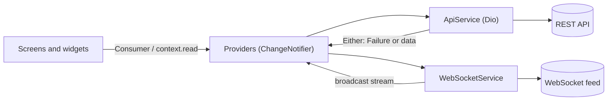

# MarketPulse

[](https://github.com/defoibrahim/marketpulse-flutter/actions/workflows/ci.yml)

<p align="center">
  
</p>

MarketPulse is a Flutter crypto market tracker. It lists markets with prices that update live over a WebSocket, opens a detail view for each pair, charts market trends and dominance, and breaks a portfolio down by allocation and P&L. It ships with a dark theme and a light theme.

I built it as a practice project to work through a realistic data-heavy mobile app: a REST client with typed failures, a live price stream, Provider-based state with loading, error and empty states, and charts.

## Screenshots

<p align="center">
  
  
  
</p>
<p align="center">
  
  
</p>

The screenshots show demo data from a local mock API (see [Data source](#data-source)).

## Features

- **Market list**: every pair with price and 24h change, colour-coded up and down.
- **Live prices**: a LIVE/OFF toggle in the app bar subscribes to a WebSocket feed. Updates are applied by symbol in O(1) and UI rebuilds are debounced, so bursts of ticks don't cause a rebuild per message.
- **Search and sort**: filter by symbol, sort by price, change or symbol, and tap a chip again to flip the order.
- **Market detail**: price, 24h change, high and low, volume and market cap, with pull-to-refresh.
- **Analytics**: total market cap and volume, BTC/ETH/others dominance (donut chart), a trend line with a 1h to 30d timeframe picker, and the top gainer and loser.
- **Portfolio**: total balance and P&L, an allocation chart (top four holdings plus "others") and the holdings list.
- **Polished states**: skeleton loading with Skeletonizer, a progress bar, retryable error views, empty and no-match states.
- **Dark and light themes**: Material 3 themes seeded from one brand colour, switchable at runtime.

## Architecture



- **Services** wrap I/O. `ApiService` returns `Either<Failure, T>` (dartz), mapping Dio errors to `NetworkFailure`, `ServerFailure` or `UnexpectedFailure`, so providers never catch exceptions. `WebSocketService` exposes a broadcast stream of decoded messages and reconnects after a drop.
- **Providers** hold screen state (`MarketDataProvider`, `AnalyticsProvider`, `PortfolioProvider`, plus theme and navigation). Services are injected through constructors and wired with `MultiProvider` in `main.dart`, which keeps providers testable with mocks.
- **Models** are immutable `Equatable` classes with `fromJson`, and `copyWith` where live updates need it.
- **UI** is split into screens and small reusable widgets, with barrel files per layer.

```
lib/
├── core/        # Failure types, app theme
├── gen/         # flutter_gen asset accessors
├── models/      # MarketData, analytics and portfolio models
├── providers/   # ChangeNotifier state
├── screens/     # Market, detail, analytics, portfolio, shell
├── services/    # ApiService (Dio), WebSocketService
├── utils/       # Constants, number formatting
└── widgets/     # List items, charts, cards, avatars
```

## Tech stack

| Area | Packages |
| --- | --- |
| Framework | Flutter (Material 3), Dart 3 |
| State | provider |
| Networking | dio, web_socket_channel |
| Functional errors | dartz (`Either`), equatable |
| Charts | fl_chart |
| UI | skeletonizer, pull_to_refresh, google_nav_bar |
| Formatting | intl |
| Tooling | flutter_lints, mocktail, flutter_gen, flutter_native_splash, flutter_launcher_icons |
| CI | GitHub Actions: `flutter analyze` and `flutter test` on every push and pull request |

## Data source

MarketPulse is a client only: **the backend isn't part of this repository.** The app talks to a small local REST and WebSocket API that serves demo market data, and it shows an error with a Retry button if that API isn't running.

The URLs are set in [`lib/utils/constants.dart`](lib/utils/constants.dart):

```dart
static const String baseUrl = 'http://192.168.1.54:3000/api'; // change to your machine
static const String wsUrl = 'ws://192.168.1.54:3000';
```

Point them at wherever your mock API runs:

| Where the app runs | Use |
| --- | --- |
| iOS simulator, desktop or web | `http://localhost:3000/api` and `ws://localhost:3000` |
| Android emulator | `http://10.0.2.2:3000/api` and `ws://10.0.2.2:3000` |
| Physical device | your computer's LAN IP, e.g. `http://192.168.1.20:3000/api` |

### API contract

Any server that implements these endpoints works, for example a small Express or json-server mock. Every REST response wraps its payload in `{ "data": ... }`.

| Request | `data` payload |
| --- | --- |
| `GET /api/market-data` | list of `{ symbol, description, price, change24h, changePercent24h, volume, high24h, low24h, marketCap, lastUpdated }` |
| `GET /api/analytics/overview` | `{ totalMarketCap, totalVolume24h, activeMarkets, topGainer, topLoser, marketDominance: { btc, eth, others }, lastUpdated }`, where movers are `{ symbol, change, price }` |
| `GET /api/analytics/trends?timeframe=24h` | `{ timeframe, data: [{ timestamp, marketCap, volume, priceIndex }], summary: { change, volatility } }` |
| `GET /api/portfolio` | `{ totalValue, totalPnl, totalPnlPercent, totalHoldings, lastUpdated }` |
| `GET /api/portfolio/holdings` | list of `{ id, symbol, quantity, averagePrice, currentPrice, value, pnl, pnlPercent, allocation, lastUpdated }` |
| `GET /api/portfolio/performance?timeframe=24h` | `{ timeframe, data: [{ timestamp, value, pnl, pnlPercent }], summary: { startValue, endValue, totalReturn } }` |
| `WS /` (server push) | `{ "type": "market_update", "data": { symbol, price, change24h, changePercent24h, volume, timestamp } }` |

Symbols look like `BTC/USD`. Timestamps are ISO 8601 strings.

## Running it

Prerequisites: the Flutter SDK (stable channel, Dart 3.9 or newer) and the mock API described above.

```bash
git clone https://github.com/defoibrahim/marketpulse-flutter.git
cd marketpulse-flutter
flutter pub get

# 1. Start your mock API on port 3000
# 2. Set baseUrl and wsUrl in lib/utils/constants.dart
flutter run
```

To see live prices, open the **Market** tab and tap **OFF** in the app bar so it switches to **LIVE**. Tap it again to stop the stream.

### Tests and analysis

```bash
flutter analyze
flutter test
```

The tests cover `MarketDataProvider`: initial state, loading success and failure, case-insensitive search and sorting, with the services mocked through mocktail. CI runs the same commands on every push and pull request.

## Roadmap

- Bundle a mock API (or an offline demo mode) so the app runs straight after cloning.
- Read the API URLs from `--dart-define` instead of editing a constants file.
- Move from pull_to_refresh to Flutter's built-in `RefreshIndicator`.
- Widen test coverage to the analytics and portfolio providers, the WebSocket service and the main widgets.

## License

No license has been chosen yet, so all rights are reserved. Ask if you'd like to reuse the code.
